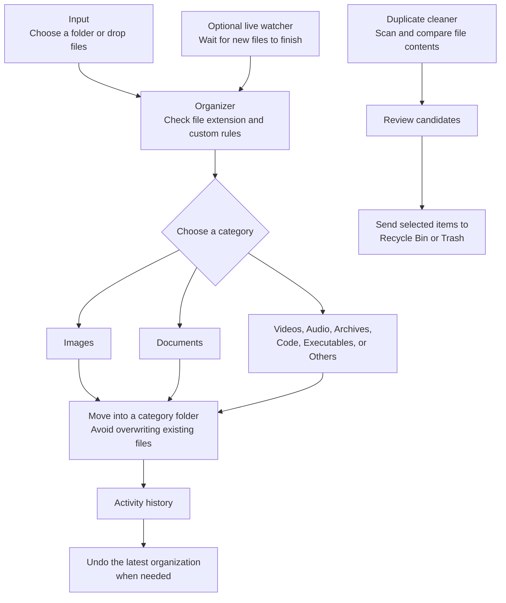

# Smart File Organizer

> **Less clutter. More room to think.**
>
> Give every file a place to land—and keep control of what moves.

Smart File Organizer helps turn a busy folder into a calmer, easier-to-browse space. Choose a folder and sort its files by type, let a desktop watcher take care of new arrivals, or review duplicates before sending them to your computer's Trash. Changes stay on your device, and recent organization can be undone.

## From a crowded folder to a clear layout



```text
┌───────────────────────────────┐
│ Input                         │
│ Choose a folder or drop files │
└───────────────┬───────────────┘
                │
       ┌────────▼─────────┐       ┌─────────────────┐
       │ File Organizer   │◄──────│ Optional watcher│
       │ Check type/rules │       │ New files       │
       └────────┬─────────┘       └─────────────────┘
                │
        ┌───────┴────────┐
        │                │
  ┌─────▼──────┐   ┌─────▼──────────┐
  │ Type-based │   │ Activity log   │
  │ folders    │   │ Review / Undo  │
  └────────────┘   └────────────────┘

  Duplicate cleaner ──► Review matches ──► System Trash
```

### Choose where to begin

Open the desktop app and select a folder—Downloads, Desktop, or another place that needs a reset. Choose **Organize now** to sort regular files directly inside that folder. Existing subfolders stay where they are.

Want to sort only a few items? Drag files into the app. Each dropped file is organized beside its original location, so files from different folders are not all redirected to one shared destination.

### Let file types find their folders

The organizer checks each file's extension and puts it into a matching category folder. For example:

| A file such as... | Finds a home in... |
| --- | --- |
| `photo.jpg`, `graphic.png` | `Images` |
| `report.pdf`, `notes.txt` | `Documents` |
| `recording.mp4` | `Videos` |
| `track.mp3` | `Audio` |
| `backup.zip` | `Archives` |
| `script.py`, `page.html` | `Code` |
| `setup.exe` | `Executables` |
| A file type without a built-in category | `Others` |

These are default examples; the available extension list can vary slightly between the Electron and Python desktop apps. You can also add custom extension rules. For instance, route `.psd` files to `Design` or `.blend` files to `3D Projects`. A custom rule takes priority over the default category.

Category folders are created beside the files being sorted. If a file with the same name already exists in the destination, the organizer gives the incoming file a numbered name rather than overwriting the existing one. Normal sorting handles files, not folders, and skips symbolic links.

## Let the busywork happen in the background

### Live folder watcher

Turn on the live watcher for a folder and new files can be sorted while the desktop app is running. The watcher waits for a new file to finish changing before moving it, so it is less likely to interrupt a download or save in progress. Recognized partial-download files are skipped.

The watcher monitors the selected folder itself, not every existing subfolder. It is optional: start it when you want automatic sorting and stop it whenever you like.

### Image auto-sort

If you prefer incoming images to stay together, start the image watcher and choose a destination root. New images are filed into a year folder and then a date folder:

```text
Screenshots_2026/
└── 2026-10-31/
    ├── photo.jpg
    └── screenshot.png
```

The watcher runs locally while the app is open. It sorts new images that arrive in the watched folder; it does not reorganize an existing photo library all at once.

## Clean up with a review step

The duplicate cleaner scans the selected folder and its subfolders. It first compares file sizes, then uses SHA-256 hashes to identify files with identical contents. Two files are not treated as duplicates just because their names look alike.

It can also flag likely temporary clutter, such as `.tmp`, `.temp`, `.cache`, editor backup files ending in `~`, and Office lock files beginning with `~$`.

The scan is a review list—not an automatic delete. Check each candidate and choose what you want to remove. Confirmed items are sent to the operating system's Recycle Bin or Trash instead of being silently erased by the app.

## Put selected items away

The private vault moves selected files or folders into a `.private_vault` folder inside the location you choose. You can view the items in that vault and restore them later. On Windows, the app marks the vault folder as hidden.

> **The vault is not encryption.** It does not use a password or prevent other people or applications from accessing the files. Use device encryption when you need to protect sensitive data.

## Know what changed—and undo it

After an organization action, the app records which files moved, where they came from, where they went, and which category they entered. The activity view gives you a recent history and category totals.

Undo returns files from the latest organization action to their original locations. Before restoring, the app checks that the original path is free and the organized file is still there. If a path is occupied or a file is missing, it reports the conflict rather than overwriting another file.

Stop an active watcher before manually organizing or undoing an action. This keeps automatic and manual file moves from competing with each other.

## Two ways to run the desktop app

This project includes two separate desktop implementations:

| App | What it is |
| --- | --- |
| **Electron desktop app** | A desktop interface built with Electron and Tailwind CSS. JavaScript in Electron's main process performs file operations through a restricted preload bridge. |
| **Python desktop app** | A standalone PyQt6 application with its own organizer, watcher, activity history, cleanup, and vault services. |

They are independent apps: the Electron application does not call or require the Python application. The hosted website is for information and downloads; choose a desktop app to work with files on your computer.

## Start the app

### Electron

Install Node.js 20 or newer. From the project folder, run:

```powershell
npm install
npm start
```

### Python

Install Python and the listed packages, then run:

```powershell
pip install -r requirements.txt
python main.py
```

To package the Windows desktop builds, run `npm run dist`. This produces a portable executable, a ZIP archive, and a setup installer. The builds are unsigned, so Windows may show a Smart App Control warning.

## Keep in mind

- Organizing moves files into category folders; it does not upload them.
- Folder-wide sorting handles files directly inside the selected folder; duplicate scanning can look through its subfolders.
- The private vault hides and relocates items but does not secure or encrypt them.
- Review cleanup candidates before sending selected files to the system Trash.
- Windows releases are unsigned and may show a security warning.

## License

Smart File Organizer is available under the [MIT License](LICENSE).
